# Модуль 3. Ввод показателей и справочник показателей

Ввод показателей обследования (давление, пульс, анализы крови) и справочник показателей с нормами. Версия приложения включает всё из модуля 2 и добавляет форму **«Обследование»**, вкладку **«Обследования»** в карте пациента и раздел **«Показатели»**.

Все окна созданы в конструкторе форм Visual Studio: у каждой формы есть `Form.cs`, `Form.Designer.cs` и `Form.resx`. Поля, списки, флажки, таблицы с колонками, кнопки и их обработчики размещены в конструкторе — форму можно открыть, прокликать и изменить мышью.

## Что в папке

| Папка | Содержимое |
|---|---|
| `Документация` | Описание модуля по формам (Word) |
| `Скриншоты` | Окна этой версии приложения |
| `Исходный_код` | Решение Visual Studio этой версии: приложение, база, тесты |

## Формы модуля

| Форма | Назначение |
|---|---|
| `ExaminationForm` | Ввод показателей обследования |
| `IndicatorForm` | Показатель справочника: норма и допустимый диапазон |
| `PatientCard` | Добавлены кнопка «Новое обследование» и вкладка «Обследования» |
| `MainForm` | Добавлен раздел «Показатели» |

## Как запустить

Нужны Windows 10 или новее, [.NET 10 SDK](https://dotnet.microsoft.com/download) и SQL Server Express LocalDB (ставится вместе с Visual Studio).

1. Откройте папку `Исходный_код`.
2. Запустите `Первый_запуск.cmd`: он соберёт приложение, создаст базу `MedTest_Dev`, спросит логины и пароли администратора и врача и по желанию добавит примеры пациентов.
3. Запустите `Открыть_приложение.cmd` и войдите.
4. `Проверить_всё.cmd` собирает решение и запускает автоматические проверки на отдельной тестовой базе.

Формы открываются в конструкторе Visual Studio: `Исходный_код/MedTest.slnx` → проект `MedTest.Desktop` → двойной щелчок по форме.

## Скриншоты

### Окно входа: неверный режим — подсказка выбрать «Врач»

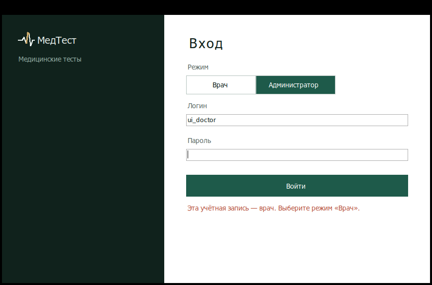

### Главное окно: список пациентов и карточка выбранного пациента

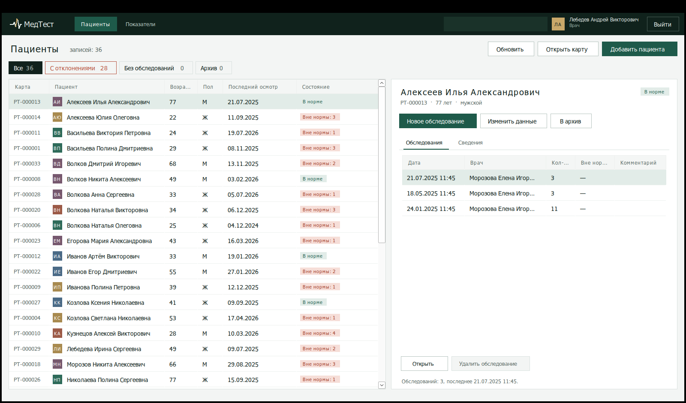

### Форма «Пациент»: дата рождения из календаря, пол из списка

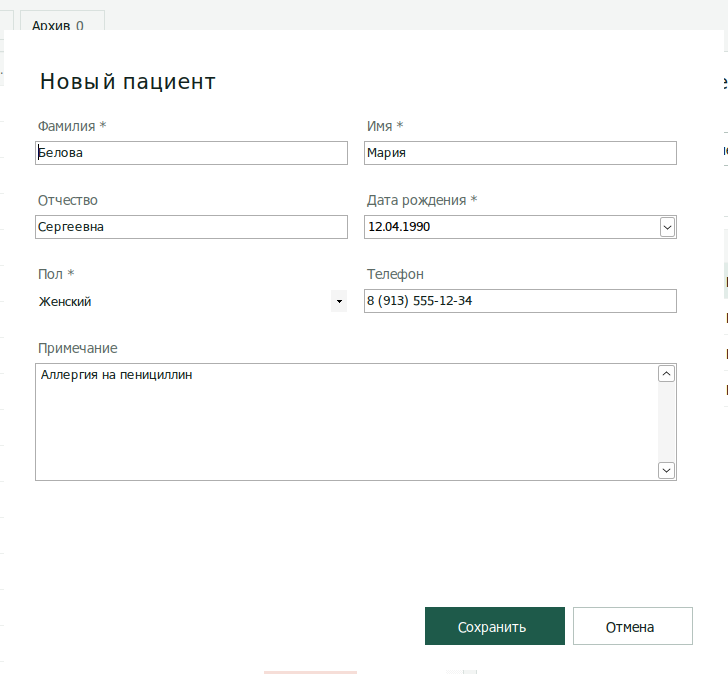

### Форма «Обследование»: ввод значений, оценка при вводе, сводка

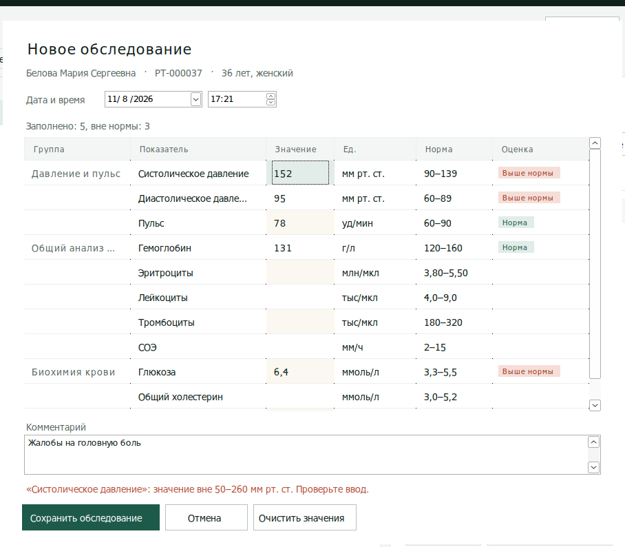

### Карточка пациента, вкладка «Сведения»

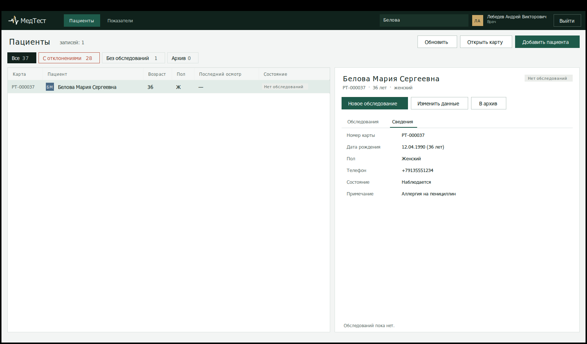

### Изменение данных пациента

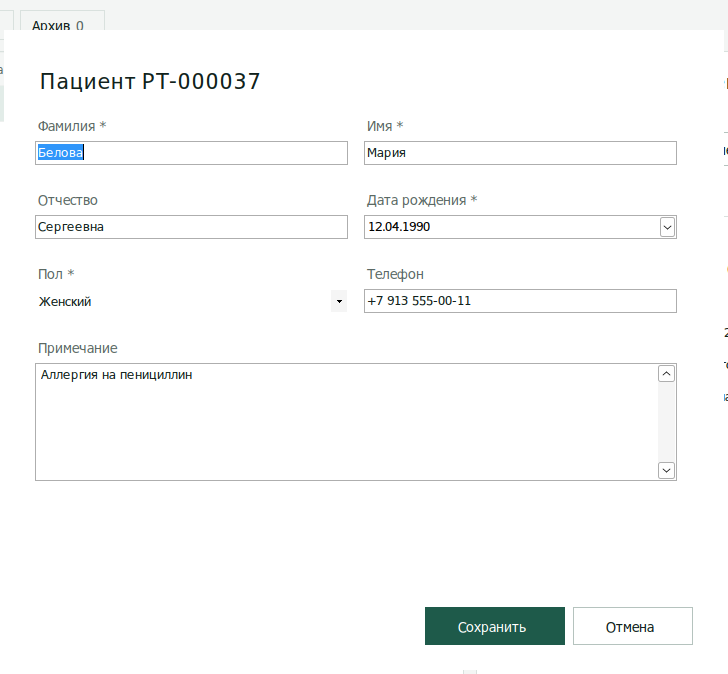

### Фильтр «Архив»: пациент в архиве и кнопка «Вернуть из архива»

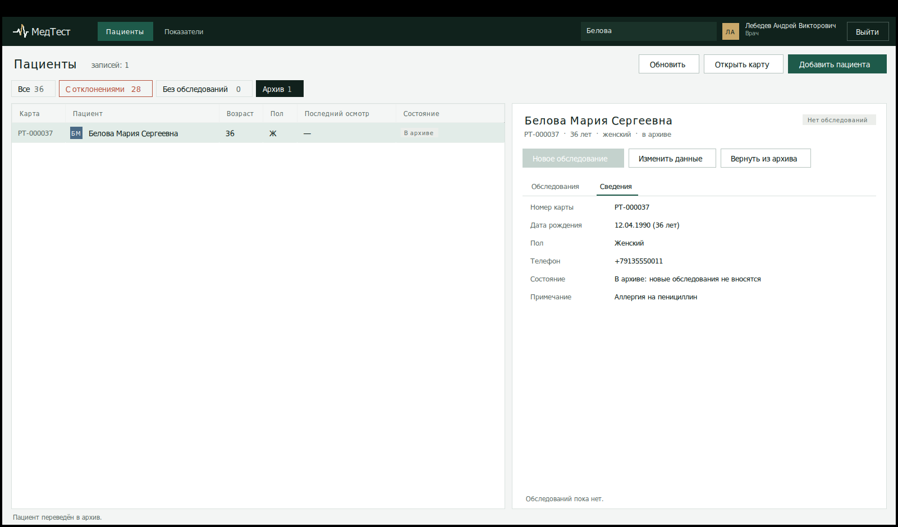

### Обследование другого врача открывается только для просмотра

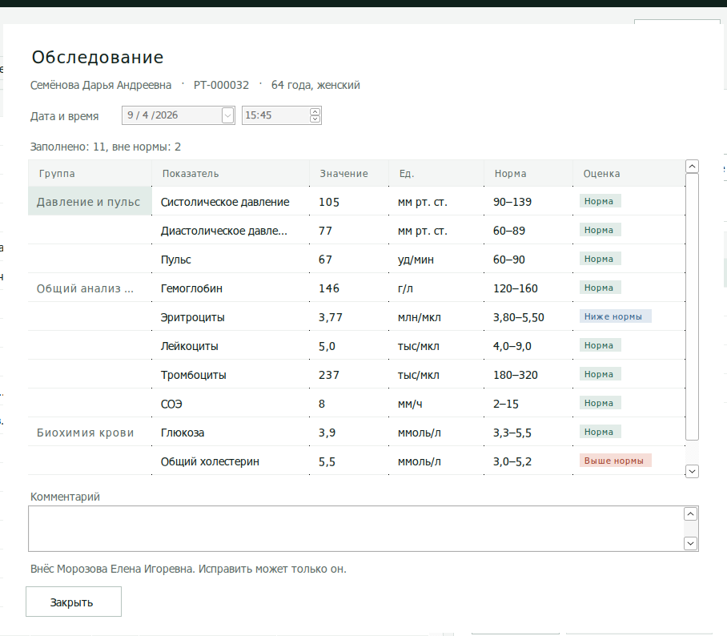

### Карта пациента: история обследований

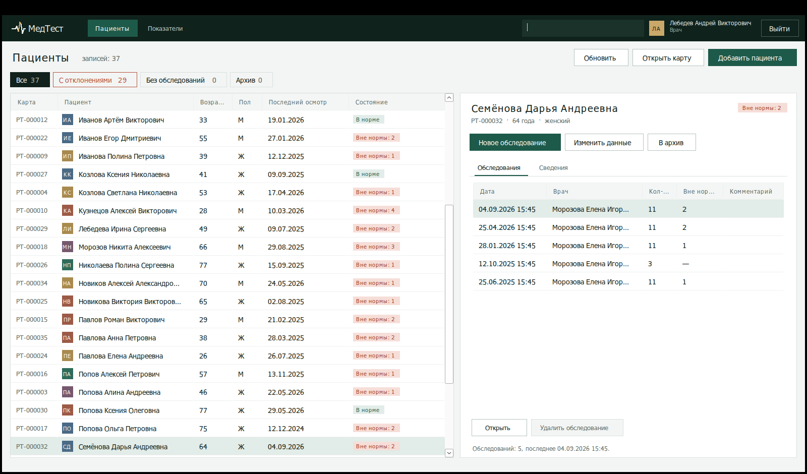

### Карта пациента: сведения

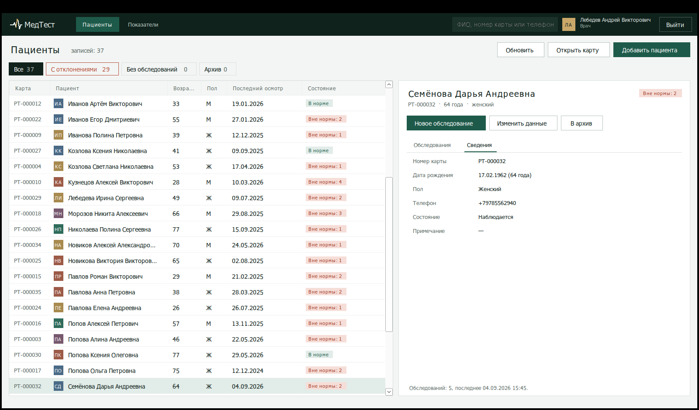

### Справочник показателей

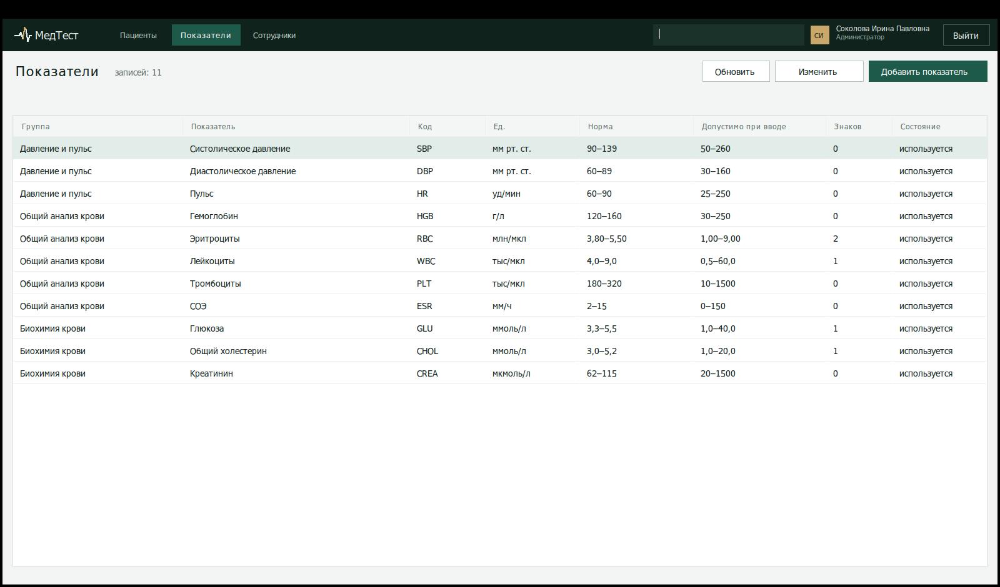

### Форма «Показатель»: норма, допустимый диапазон, флажок «Используется»

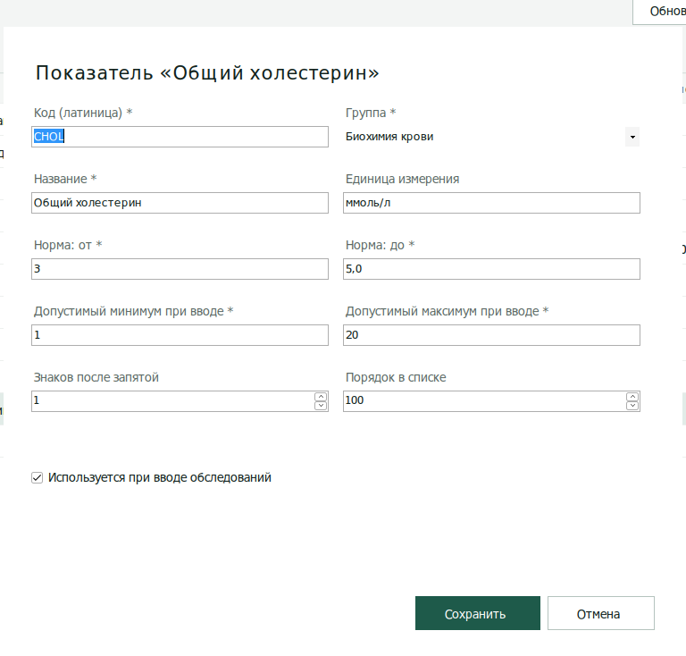

### Раздел «Сотрудники»

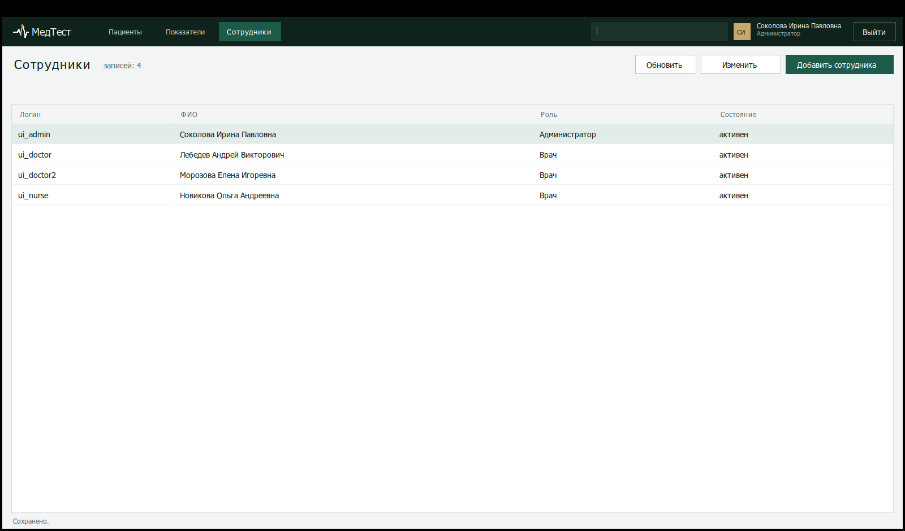

### Форма «Сотрудник»: роль из списка, флажок «Активен»

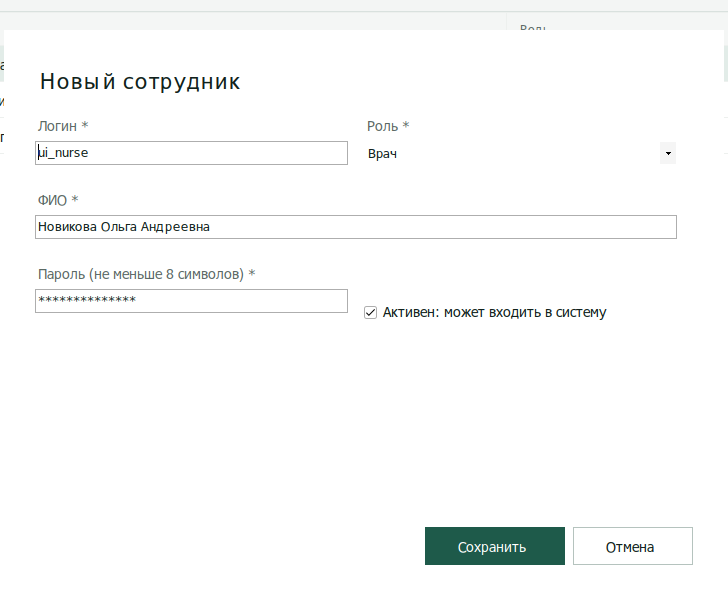
